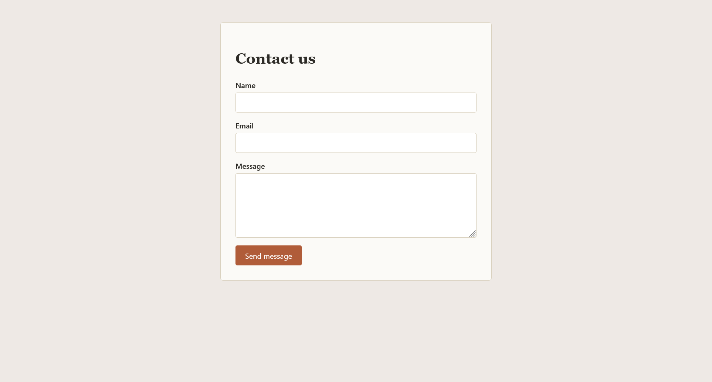
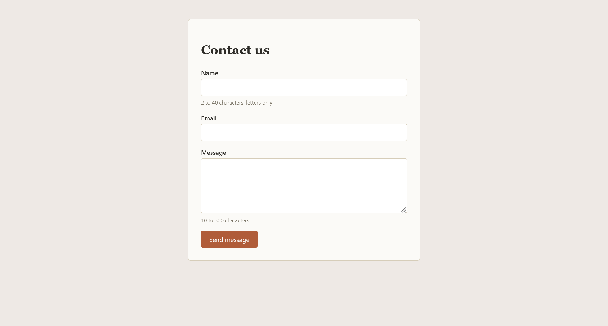
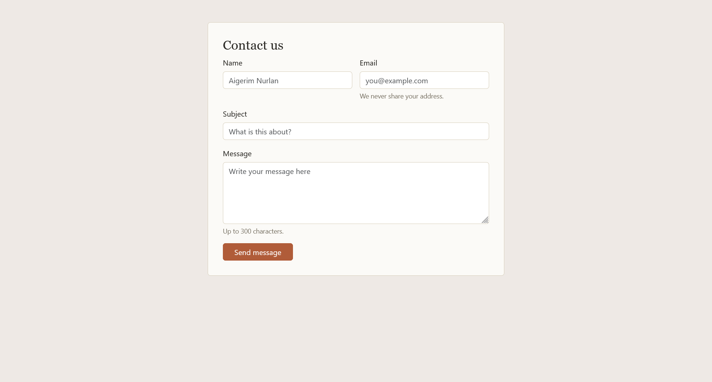
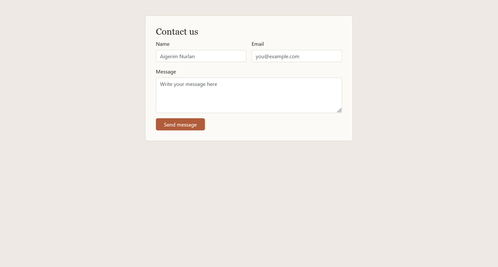
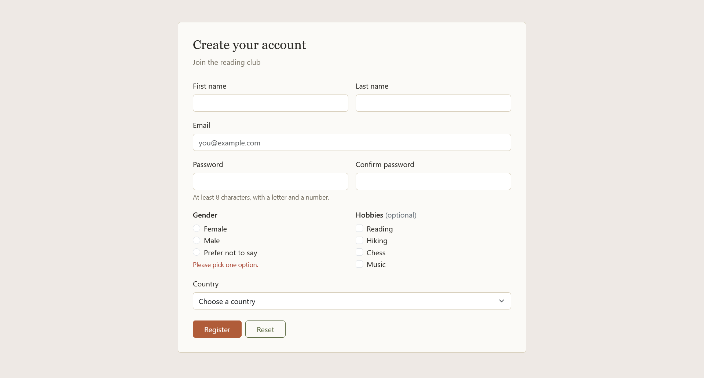

# Forms and validation (assignment 4)

- **Name:** Sergey
- **Group:** SE-2540
- **Live site:** https://dar-key.github.io/web-forms-and-validation
- **Repository:** https://github.com/dar-key/web-forms-and-validation

---

## Part 1. Basic HTML Forms

### Task 0. Simple Contact Form

### Task 1. Form with HTML5 Validation

Add built-in validation attributes and test how the browser handles them.

I used required, minlength, maxlength, type="email" and a pattern on the name. I tested an empty form, a bad email and a short message. The browser blocks the submit each time.

---

## Part 2. Bootstrap Forms

### Task 2. Bootstrap Form Styling

Recreated the contact form with Bootstrap classes and the grid, with placeholders and helper text.

Name and email sit side by side on medium screens and stack on phones.

### Task 3. Bootstrap Validation Styles

Used is-valid and is-invalid with feedback messages, and test with valid and invalid data.

A small script reads each field's validity and sets the classes. The messages are in valid-feedback and invalid-feedback blocks.

---

## Part 3. Advanced Form Project

### Task 4. Registration Form

Built a registration form with names, email, password and confirmation, gender radios, hobby checkboxes, a country select, and submit and reset buttons. It is responsive and validated.

The layout uses the Bootstrap grid. The password needs at least 8 characters with a letter and a number, and the confirmation must match it. The gender group shows an error if nothing is picked. Reset clears all validation states.

## Summary

I built the plain HTML forms first, then recreated them with Bootstrap. For tasks 3 and 4 I wrote a script that uses the built-in validity of each field to set the Bootstrap classes. I tested every form with empty, invalid and valid input, and at phone width.
